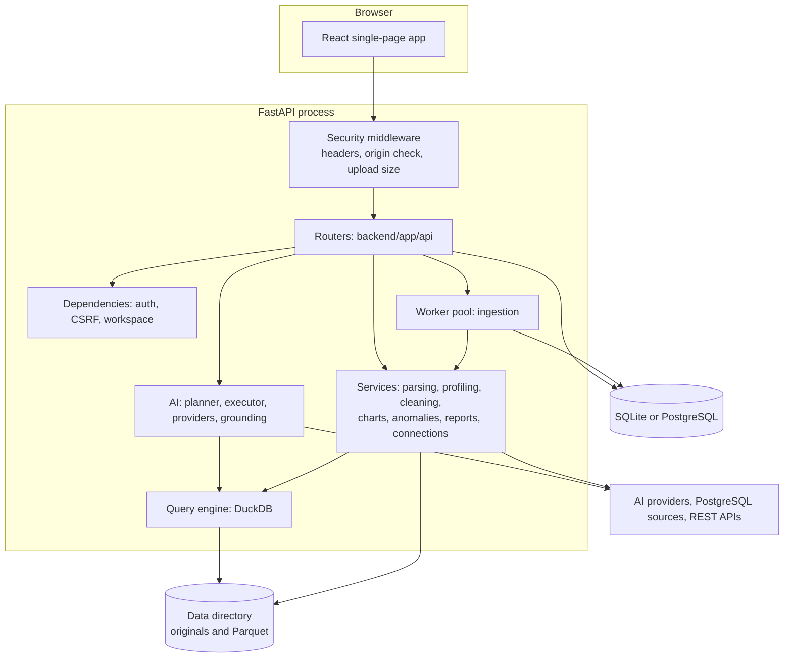
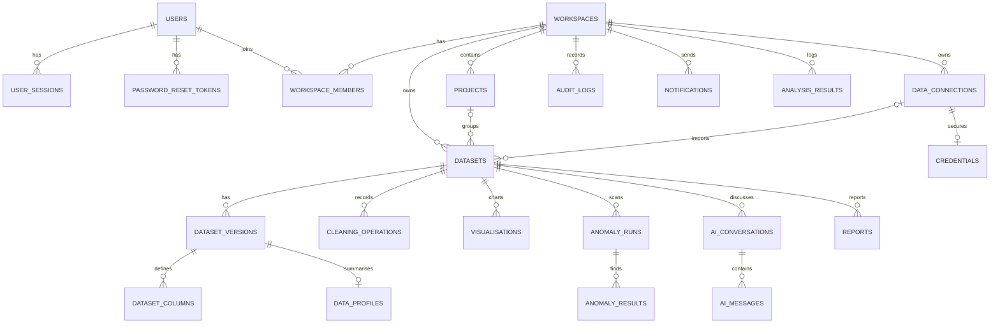

# Architecture

## Overview

DataForge AI is a single deployable application: a FastAPI server that hosts a JSON API and the built React front end. It keeps metadata in a SQL database and dataset contents in Parquet files.



## Key decisions

| Decision | Reason | Trade-off |
|---|---|---|
| Parquet files plus SQL metadata | Datasets of millions of rows don't belong in ordinary database rows. Parquet is compact and columnar, and versions are immutable. | Files and database must be backed up together. |
| DuckDB for queries | Fast analytical SQL over Parquet, with no server and bounded memory | One connection per query, which is simple and isolated |
| pandas for ingestion, cleaning, and statistics | Mature, testable, and clear for row-level logic | Loads whole versions into memory, hence row limits |
| SQLite default, PostgreSQL supported | Zero-configuration start for evaluation, and the same schema and migrations work on both | SQLite suits one server and light concurrency. Use PostgreSQL for shared use. |
| In-process worker pool | No extra service to install. Interrupted jobs requeue at startup. | Assumes one process, and a job can't be force-stopped at its time limit, only between stages |
| Structured analysis plans | AI models never write SQL, so injection and invented calculations are designed out | Only supported operations can be answered |
| Session cookies, not tokens in browser storage | HttpOnly cookies can't be read by scripts | CSRF protection is required, and is implemented |
| No state-management or data-fetching library | Small hooks and context cover the app's needs | Some manual loading logic |

## Back end

| Path | Responsibility |
|---|---|
| `app/main.py` | App setup, security middleware, error handlers, static hosting |
| `app/config.py` | Settings from the environment and `.env` |
| `app/db.py`, `app/models.py` | Engine, sessions, and tables |
| `app/deps.py` | Current user, CSRF check, workspace context, role checks, tenant-scoped lookups |
| `app/security.py` | Password hashing, tokens, encryption, rate limiter |
| `app/api/*` | HTTP endpoints. Routers stay thin and authorise every request. |
| `app/services/parsing.py` | File validation and parsers |
| `app/services/inference.py` | Column type inference |
| `app/services/profiling.py` | Statistics and quality checks |
| `app/services/ingestion.py` | Pipeline, and `save_version`, the one path that stores versions |
| `app/services/query_engine.py` | Locked-down DuckDB connections and safe SQL building |
| `app/services/cleaning.py`, `charts.py`, `anomaly.py` | Cleaning operations, chart calculation, detection |
| `app/services/reports.py`, `report_pdf.py`, `exports.py` | Report content, PDF rendering, and safe CSV and XLSX export |
| `app/services/connections.py` | SSRF-protected HTTP and read-only PostgreSQL |
| `app/ai/*` | Plan schema, rule-based planner, executor, providers, orchestration, grounding |

## Data flow: upload

1. The middleware checks the declared size. The router streams the file to a temporary name, counting bytes.
2. `detect_format` checks the signature and extension. Failures return 415 and leave nothing behind.
3. The original moves to storage, a dataset row is created with status `queued`, and a job is submitted. The API returns 202.
4. The worker parses, infers types, profiles, and writes Parquet, updating `stage` and `progress`.
5. `save_version` stores the version, columns, and profile, then sets the dataset to `ready`. A notification follows.

The browser polls for status while anything is processing.

## Data flow: question

See [docs/AI_ANALYSIS.md](docs/AI_ANALYSIS.md).

## Database

Migrations are in `backend/alembic/versions`, and a test confirms they match the models on PostgreSQL.



Conversations play the role of analysis sessions, and `analysis_results` is the history shown on the dashboard. Deleting a workspace or dataset removes derived rows by cascade. `datasets.current_version_id` is deliberately not a foreign key, because it would create a circular dependency with `dataset_versions`.

## Storage layout

```text
<DATA_DIR>/
├── dataforge.db                 SQLite database, when DATABASE_URL is empty
├── .local_secrets.json          Development secrets, only if none are configured
└── workspaces/<workspace id>/datasets/<dataset id>/
    ├── original/source.<ext>    Untouched upload
    └── versions/<version id>.parquet
```

Parquet files contain a generated `__row_id` column, so findings can point to specific records. It is hidden from column lists.

## Front end

| Path | Responsibility |
|---|---|
| `src/main.tsx` | Routes, route protection, lazy-loaded pages |
| `src/lib/api.ts` | API client, CSRF and workspace headers, upload progress, downloads |
| `src/lib/context.tsx` | Session, workspace, active dataset (in the URL), and toasts |
| `src/lib/hooks.ts` | Data loading, debouncing, polling |
| `src/components/ui.tsx` | Design system components |
| `src/components/ChartView.tsx` | All chart rendering and export |
| `src/components/Layout.tsx` | Sidebar, top bar, search, notifications |
| `src/pages/*` | One file per page |

Design tokens are in `tailwind.config.js`. Route protection in the browser is only for convenience; the server enforces all access.

## Security architecture

See [SECURITY.md](SECURITY.md).

## Scaling beyond one server

Three things assume one process: the worker pool, the rate limiter, and local file storage. To run several instances, replace them with a job queue, a shared rate-limit store, and object storage or a shared volume. `services/jobs.py`, `security.RateLimiter`, and `services/storage.py` are the single places to change.
