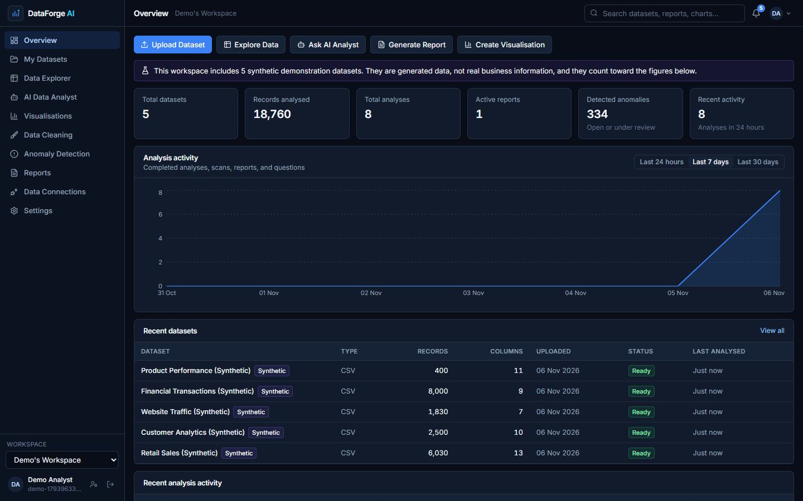
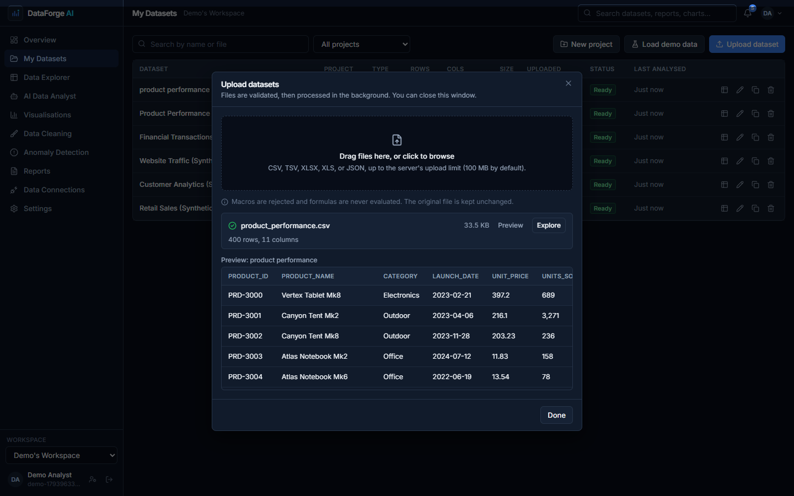
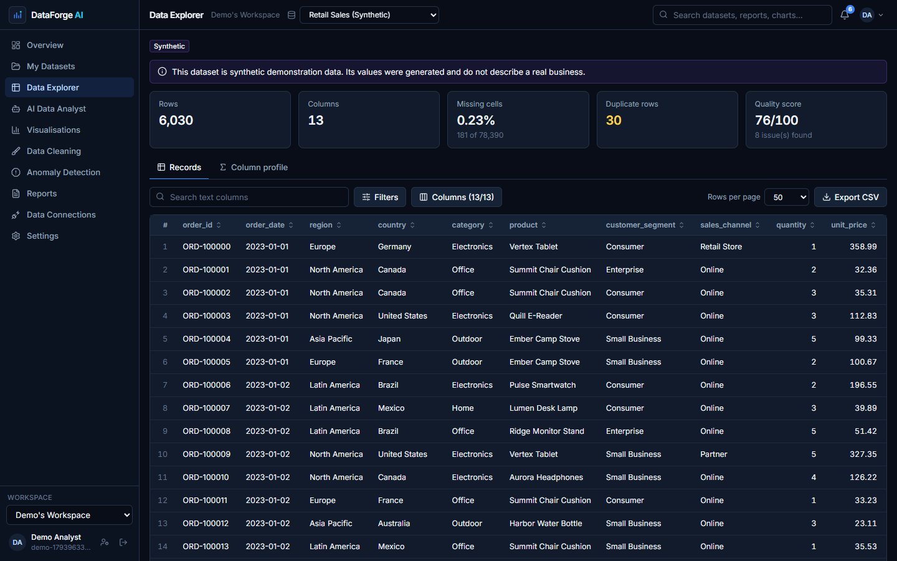
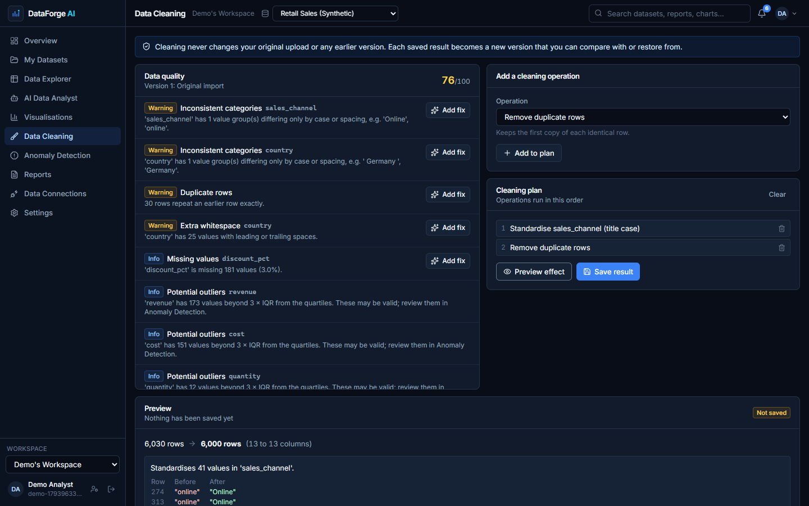
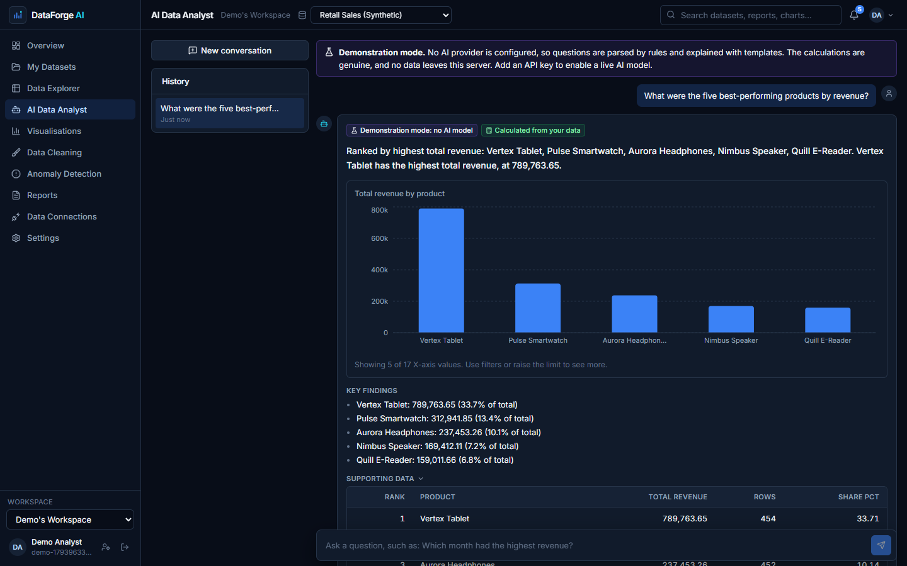
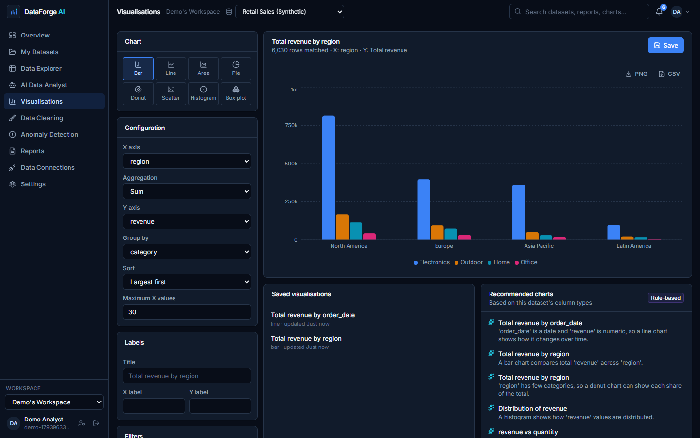
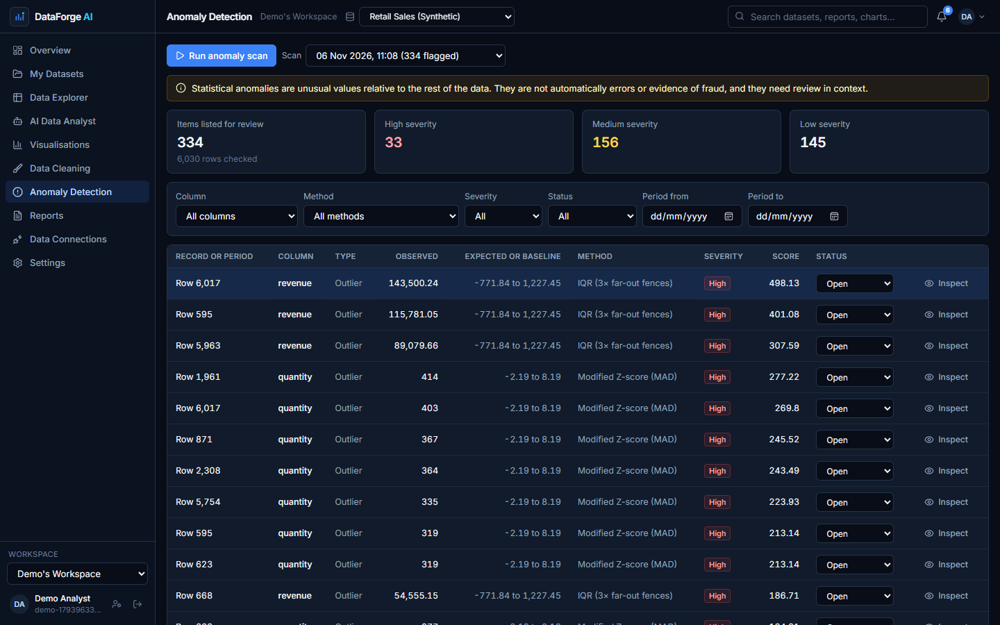
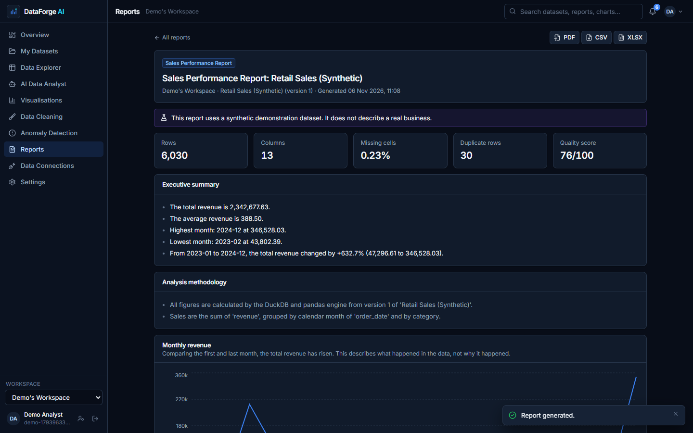
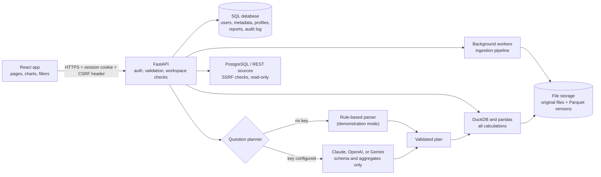

# DataForge AI

**An AI-powered data analytics platform for exploring datasets, discovering insights, detecting anomalies, generating visualisations, and creating intelligent reports.**




## What it is

DataForge AI turns a spreadsheet or data export into something you can question, chart, clean, and report on, without writing code. Upload a file, and the platform checks it, works out each column's type, profiles the data, and flags quality problems. You can then browse the records, ask questions in plain English, build charts, scan for unusual values, and export a report.

**The problem it solves:** spreadsheets become slow and error-prone at scale, BI tools take time to set up, and general AI chatbots can state figures that nobody calculated. Here, a data engine calculates every number, and the AI only plans the calculation and explains its result.

**Who it is for:** business analysts, data analysts, small and medium-sized businesses, founders, students, researchers, and developers.

### How it works

| Stage | What happens |
|---|---|
| **Dataset analysis** | Files are validated by content, parsed safely, and converted to Parquet. Types, statistics, and quality issues are stored for each version. |
| **AI-assisted analysis** | A question becomes a structured, validated plan. DuckDB runs that plan on your data. The AI receives only the column structure and the aggregated results, and any figure it writes that doesn't match the results is rejected. |
| **Visualisation** | You choose fields in the studio, the server validates the combination and calculates the values, and the browser draws them. |
| **Reports** | Six report types combine calculated tables, charts, methodology, and limitations, and export to PDF, CSV, and XLSX. |

No API key is needed to try it. Without one, the app runs in a clearly labelled **demonstration mode**: a rule-based parser replaces the AI model, and the calculations remain genuine.

## Product preview

These are genuine screenshots of the running application, using only synthetic demonstration data.

| | |
|---|---|
| **Main dashboard**<br> | **Dataset upload**<br> |
| **Data Explorer**<br> | **Data Cleaning**<br> |
| **AI Data Analyst (demonstration mode)**<br> | **Visualisation Studio**<br> |
| **Anomaly Detection**<br> | **Reports**<br> |

## Features

### Fully implemented and tested

- **Upload:** CSV, TSV, XLSX, XLS, and JSON (including NDJSON), with drag and drop, progress, content-based validation, size, row, and column limits, background processing, and rejection of macros and archive bombs.
- **Data management:** rename, describe, duplicate, delete, search, projects, versions, and version restore. Original files are never altered.
- **Data Explorer:** server-side pagination, sorting, search, column selection, typed filters, CSV export, and statistics suited to each column type.
- **Data quality and cleaning:** checks for missing values, duplicates, inconsistent types, invalid dates, potential outliers, empty columns, inconsistent categories, and formatting. Ten cleaning operations, each previewed before saving, with history.
- **AI Data Analyst:** grounded questions with supporting tables, charts, and calculation details, conversation history, honest handling of unanswerable questions, and demonstration mode.
- **Visualisation Studio:** bar, line, area, pie, donut, scatter, histogram, and box plot; six aggregations, grouping, filters, labels, saved charts, range selection on long axes, recommendations, and PNG and CSV export.
- **Anomaly Detection:** outliers, sudden changes over time, frequency changes, missing-data patterns, and rare categories, with methods chosen per column, record inspection, review status, and charts.
- **Reports:** Dataset Overview, Data Quality, Sales Performance, Trend Analysis, Anomaly Detection, and Custom Analysis, exported to PDF, CSV, and XLSX.
- **Data connections:** read-only PostgreSQL table import and REST API import, with encrypted credentials and SSRF protection.
- **Accounts:** registration, login, sessions, profile, password change and reset, workspaces, four roles, and an audit log.
- **Security:** see [Security and privacy](#security-and-privacy).

### Partially implemented

- **Live AI providers:** Anthropic Claude, OpenAI, and Google Gemini are implemented, but were tested only against simulated API responses, because no API keys were available. Try one with your own key before relying on it.
- **Password reset e-mail:** the flow is complete and tested, but SMTP delivery has not been exercised against a real mail server. In development, the link appears on screen.
- **Charts in PDF reports:** bar and line charts are drawn. Other chart types appear in the browser and as tables in the PDF.
- **macOS and Linux scripts:** written and syntax-checked, but not run on those systems.

### Planned

See the [roadmap](#roadmap).

## Technology stack

| Area | Technology |
|---|---|
| Front end | React 19, TypeScript 7, Vite 8, Tailwind CSS 3, React Router 7 |
| Charts and icons | Recharts 3 (the box plot is custom SVG), Lucide |
| Back end | Python 3.12, FastAPI, Pydantic 2, Uvicorn |
| Database | SQLAlchemy 2, Alembic; SQLite by default, PostgreSQL supported and tested |
| Data processing | DuckDB (queries over Parquet), pandas and NumPy (parsing, profiling, cleaning, anomalies), PyArrow |
| File parsing | pandas CSV reader, openpyxl with defusedxml, xlrd |
| AI providers | Anthropic Python SDK; OpenAI and Gemini through their REST APIs using httpx |
| Reports | ReportLab (PDF), openpyxl (XLSX) |
| Security | argon2-cffi (passwords), cryptography/Fernet (stored credentials) |
| Testing | pytest, pgserver (real PostgreSQL in tests), Vitest, Testing Library, Playwright |
| Tooling | Ruff, pip-audit, npm audit, GitHub Actions workflow, Docker Compose (optional PostgreSQL) |

## Architecture



- **Front end:** a single-page app. Pages load on demand, and shared components live in `frontend/src/components`.
- **Back end:** routers in `backend/app/api` handle HTTP and authorisation, while `services` and `ai` hold the logic.
- **Ingestion and storage:** the untouched original is kept, and each version is an immutable Parquet file. Only metadata goes into the SQL database.
- **Data processing:** DuckDB runs queries in an isolated, locked-down connection, using only generated SQL with bound parameters.
- **AI pipeline:** question, validated plan, engine calculation, explanation, then a check of every number in the explanation.
- **Reports:** assembled from engine results, stored as structured content, and rendered on demand.
- **Database relationships:** users belong to workspaces through memberships, and everything else hangs off a workspace.

Details are in [ARCHITECTURE.md](ARCHITECTURE.md). Topic guides: [data processing](docs/DATA_PROCESSING.md), [AI analysis](docs/AI_ANALYSIS.md), [visualisation](docs/DATA_VISUALISATION.md), [anomaly detection](docs/ANOMALY_DETECTION.md), and [data privacy](docs/DATA_PRIVACY.md).

## Project structure

```text
DataForge-AI/
├── backend/
│   ├── alembic/ Database migrations
│   ├── app/
│   │   ├── ai/ Plans, rule-based planner, executor, providers, grounding check
│   │   ├── api/ HTTP routers, one per product area
│   │   ├── services/ Parsing, inference, profiling, cleaning, charts, anomalies, reports, connections
│   │   ├── config.py Environment settings
│   │   ├── deps.py Authentication, CSRF, and workspace authorisation
│   │   ├── main.py Application, security middleware, static hosting
│   │   ├── models.py Database tables
│   │   └── security.py Hashing, tokens, encryption, rate limiter
│   ├── scripts/ Sample data generator and .env creator
│   └── tests/ pytest suite, including real PostgreSQL tests
├── frontend/
│   ├── e2e/ Playwright journey and screenshot capture
│   └── src/
│       ├── components/ Layout, design system, charts, filters
│       ├── lib/ API client, types, state, formatting
│       ├── pages/ One file per page
│       └── test/ Vitest suite
├── sample_datasets/ Five synthetic CSV files
├── docs/ Topic guides, screenshots, publication guide, release notes
├── .github/workflows/ci.yml Lint, tests, and dependency audits
├── setup.bat, start.bat Windows scripts
├── setup.command, start.command macOS and Linux scripts
├── docker-compose.yml Optional local PostgreSQL
├── .env.example Configuration template (placeholders only)
└── README.md, INSTRUCTION.md, ARCHITECTURE.md, SECURITY.md,
    API_DOCUMENTATION.md, CHANGELOG.md, CONTRIBUTING.md
```

## Requirements

| Tool | Version verified | Needed for |
|---|---|---|
| Python | 3.12.10 | Back end (3.12 or newer) |
| Node.js and npm | 24.20.0 and 11.19.0 | Building the front end (setup requires Node 20 or newer) |
| Git | 2.55 | Cloning |
| PostgreSQL | Optional | Shared or production deployments; SQLite works without any setup |

## Quick start on Windows

```bash
git clone <your-repository-url>
```

```bash
cd dataforge-ai-analytics-platform
```

```bash
setup.bat
```

```bash
start.bat
```

The app opens at <http://127.0.0.1:8000>. Create an account, then choose **Load demonstration data** to try every feature with synthetic data.

On macOS or Linux, use `./setup.command` and `./start.command`. Full manual steps, PostgreSQL setup, and storage options are in [docs/INSTALLATION.md](docs/INSTALLATION.md).

> **OneDrive and similar folders:** the project works in a synced folder, but `.venv`, `node_modules`, and `data` create many files that the sync client will try to upload. Prefer a non-synced folder, or exclude those folders from syncing.

## Environment variables

The setup scripts create `.env` from [.env.example](.env.example), with new random secrets. All variables are optional in development.

| Group | Variables |
|---|---|
| Application | `ENVIRONMENT`, `SECRET_KEY`, `ENCRYPTION_KEY` (the two keys are required in production) |
| Database and storage | `DATABASE_URL`, `DATA_DIR` |
| Authentication and browser | `SESSION_TTL_HOURS`, `COOKIE_SECURE`, `CORS_ORIGINS`, `PUBLIC_APP_URL` |
| Limits | `MAX_UPLOAD_MB`, `MAX_ROWS`, `MAX_COLUMNS`, `MAX_PAGE_SIZE`, `QUERY_TIMEOUT_SECONDS`, `QUERY_MEMORY_LIMIT`, `INGEST_TIMEOUT_SECONDS` |
| Background processing | `JOB_WORKERS` |
| Rate limits | `RATE_LIMIT_AUTH_PER_MINUTE`, `RATE_LIMIT_AI_PER_MINUTE`, `RATE_LIMIT_UPLOAD_PER_MINUTE` |
| AI providers | `AI_PROVIDER`, `AI_TIMEOUT_SECONDS`, `AI_SHARE_CATEGORY_VALUES`, `AI_MAX_CONTEXT_TURNS`, `ANTHROPIC_API_KEY`, `ANTHROPIC_MODEL`, `OPENAI_API_KEY`, `OPENAI_MODEL`, `GEMINI_API_KEY`, `GEMINI_MODEL` |
| External connections | `ALLOW_PRIVATE_CONNECTIONS`, `CONNECTION_TIMEOUT_SECONDS`, `CONNECTION_MAX_ROWS`, `CONNECTION_MAX_RESPONSE_MB` |
| E-mail | `SMTP_HOST`, `SMTP_PORT`, `SMTP_USERNAME`, `SMTP_PASSWORD`, `SMTP_FROM` |
| Hosting | `FRONTEND_DIST` |

Each variable is explained in `.env.example`.

## Using the application

1. **Register and log in.** Registration creates a private workspace for you.
2. **Upload a dataset.** Under **My Datasets**, choose **Upload dataset** and drop in a file. Processing runs in the background, then a preview appears.
3. **Explore records.** **Data Explorer** shows the rows, 50 per page by default.
4. **Inspect column statistics.** Open the **Column profile** tab. Each column shows statistics suited to its type.
5. **Filter and sort.** Click a column heading to sort. Use **Filters** for conditions such as `revenue greater than 1000`.
6. **Clean a dataset.** In **Data Cleaning**, add a suggested fix or an operation, choose **Preview effect**, then **Save result**. You can save a new version or a new dataset.
7. **Create a chart.** In **Visualisations**, pick a chart type and fields. The chart updates as you go, and you can save it or export it.
8. **Ask the analyst.** In **AI Data Analyst**, ask, for example, "Which month had the highest revenue?" Open **How this was calculated** to see the columns, filters, and method.
9. **Detect anomalies.** In **Anomaly Detection**, choose **Run anomaly scan**, then **Inspect** a finding to see its original records, and set its review status.
10. **Generate a report.** In **Reports**, choose **Generate report**, then a dataset and a type.
11. **Export results.** Export filtered rows from the explorer, charts from the studio, and reports as PDF, CSV, or XLSX. Exports neutralise spreadsheet formulas.

## Testing

```bash
cd backend && ..\.venv\Scripts\python -m pip install -r requirements-dev.txt && ..\.venv\Scripts\python -m pytest
```

```bash
cd frontend && npm test
```

```bash
cd frontend && npx playwright test
```

Results from the final run on Windows 11, Python 3.12.10, and Node 24.20.0:

| Suite | Result |
|---|---|
| Backend (pytest), including statistics checked against independent pandas calculations | **211 passed** |
| Backend tests on a real PostgreSQL server (included above) | 4 passed |
| Front end (Vitest) | **12 passed** |
| End-to-end in Microsoft Edge (Playwright), including screenshot capture | **5 passed** |
| Ruff linting, including security rules | Clean |
| `pip-audit` and `npm audit` | No known vulnerabilities |
| `setup.bat` and `start.bat`, from a clean copy in a path with spaces and parentheses | Passed |

End-to-end tests use an installed Microsoft Edge by default. Set `E2E_CHANNEL=chrome` to use Chrome.

## API documentation

The API is JSON over HTTP under `/api`. Authentication uses an HttpOnly session cookie set by `POST /api/auth/login`. State-changing requests also need the `X-CSRF-Token` header. `X-Workspace-Id` selects the workspace.

Endpoint groups: authentication, workspaces and members, projects, datasets and versions, rows and export, cleaning, charts and saved visualisations, AI analyst, anomaly detection, reports, connections, overview, search, notifications, and audit logs.

Interactive documentation is at <http://127.0.0.1:8000/api/docs> while the app is running. The full reference is in [API_DOCUMENTATION.md](API_DOCUMENTATION.md).

## Security and privacy

- **Authentication:** Argon2 password hashes, random session tokens stored only as hashes, HttpOnly SameSite cookies, CSRF tokens, and rate limits.
- **User data isolation:** the server checks workspace membership on every request. Other workspaces' records return 404. Tests confirm this across every resource type.
- **File validation:** the content must match the extension. Macros, binaries, and archive bombs are rejected, and uploaded content is never executed.
- **Upload limits:** file size, rows, columns, processing time, and query time and memory all have limits.
- **Storage protection:** generated file names, per-workspace folders, and path checks. Dataset files are **not** encrypted at rest by the application, so use disk or volume encryption in production.
- **AI data processing:** raw rows are never sent to a provider. See [docs/DATA_PRIVACY.md](docs/DATA_PRIVACY.md).
- **Credential management:** connection secrets are encrypted and never returned by the API, and API keys stay on the server.
- **Export safety:** CSV and XLSX exports neutralise formula injection.
- **Audit logging:** important operations are recorded with identifiers and counts, not dataset contents.

The full security model and its limits are in [SECURITY.md](SECURITY.md).

## Limitations

- **File formats:** CSV, TSV, XLSX, XLS, and JSON. Only the first non-empty worksheet is imported. Password-protected workbooks and workbooks with macros are rejected.
- **Size limits:** 100 MB, 2,000,000 rows, and 500 columns by default, all configurable. Measured on the development laptop, a 1,000,000-row, 55 MB CSV took about 21 seconds to ingest, and a sorted, filtered page took about 0.2 seconds. Cleaning, profiling, and anomaly scans load the whole version into memory.
- **Features needing AI keys:** free-form understanding of varied questions, AI-written explanations, and AI ranking of chart suggestions. Everything else works without a key.
- **Demonstration mode:** the rule-based parser understands common English analytical phrasing only, and says so when it can't match a question.
- **External connections:** one-time copies with no scheduled sync. REST import uses GET and JSON only. PostgreSQL import reads whole tables or views, up to 200,000 rows by default.
- **Unsupported analytical operations:** forecasts, causal explanations, joins across datasets, and free-form SQL. These are declined rather than estimated.
- **Anomaly detection:** does not model seasonality, and does not use machine-learning methods such as Isolation Forest.
- **Deployment:** one server process is assumed. Background workers and rate limits live in that process, so multiple instances would need a shared queue and rate-limit store.
- **Accounts:** no multi-factor authentication, single sign-on, or e-mail invitations. Members must register before being added.

## Roadmap

### Completed in this pre-release

Upload and ingestion, explorer, profiling, cleaning and versions, visualisation studio, grounded analyst with a provider abstraction, anomaly detection, reports, connections, workspaces, security controls, tests, and documentation.

### Next

1. Verify live AI providers with real keys and add provider evaluation tests.
2. Run and fix the macOS and Linux scripts, then run the Docker and CI configuration.
3. Add seasonality-aware baselines to anomaly detection.
4. Add multi-sheet selection for Excel uploads.
5. Add e-mail invitations and multi-factor authentication.
6. Add scheduled connection refreshes.
7. Move background work and rate limits to shared services for multi-instance deployments.
8. Add application-level encryption for stored dataset files.

## Contributing

Fork the project, create a branch from `main`, make your change with tests, run the suites above, and open a pull request. See [CONTRIBUTING.md](CONTRIBUTING.md).

## License

DataForge AI is released under the [MIT License](LICENSE). You may use, change, and distribute it, including commercially, as long as you keep the copyright and licence notice. It comes with no warranty.

## Disclaimer

DataForge AI is an analytical assistance tool. It does not provide financial, legal, or professional advice. Independently verify important business decisions, and review analytical assumptions, data quality, and AI-generated interpretations. A flagged anomaly is not proof of an error or of fraud. Sample datasets are synthetic and do not describe any real business.
