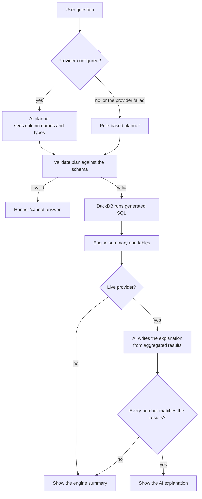

# AI analysis

The AI Data Analyst follows one rule: **the data engine calculates, and the AI explains.** A language model never produces a figure that reaches the user unchecked.

## Pipeline

## The analysis plan

Planners can only produce an `AnalysisPlan` (`backend/app/ai/plan.py`). They can't write SQL.

| Operation | Purpose |
|---|---|
| `metric` | One aggregate, such as the average of a column |
| `group_aggregate` | An aggregate per group, ranked |
| `time_series` | An aggregate per day, week, month, quarter, or year |
| `period_comparison` | Matching months or quarters across recent calendar years |
| `dataset_summary` | Structure, quality, and main patterns |
| `distribution` | Descriptive statistics |
| `correlation` | Pearson correlation |
| `anomaly_scan` | Statistical anomaly detection |
| `chart_recommendation` | Suitable charts for the columns |
| `unsupported` | A declined request, with the reason |

`validate_plan` rejects unknown columns, unsuitable types, and invalid filters. If a plan fails, the user sees why, and no calculation runs.

Column names go into SQL only after matching the stored schema and being quoted. Values are always bound parameters. Tests confirm that plans containing invented columns or SQL fragments are refused.

## Response format

| Section | Content |
|---|---|
| Direct answer | One or two sentences |
| Supporting data | The exact result table, and a chart where useful |
| Key findings | Specific findings with their values |
| Interpretation | Plain-language meaning, without claiming causes |
| Limitations | For example, an incomplete final month |
| Suggested follow-ups | Further questions the data could answer |
| How this was calculated | Dataset, version, columns, filters, time range, method, rows used, and what was shared with a provider |

## Grounding check

After a live model writes its explanation, `check_grounding` extracts every number and compares it with the calculated results, allowing for equivalent rounding. Small whole numbers up to 12 are allowed, since they usually count things ("the top 5").

If any number can't be traced, the AI text is discarded, the engine's own summary is shown, and a notice explains why. This check catches invented figures, but not a misleading statement using correct figures, so users should still review interpretations.

## Providers

`backend/app/ai/providers.py` defines one small interface, `complete_json(system, user, schema)`.

| Provider | Client | Default model | Status |
|---|---|---|---|
| Anthropic Claude | Official Python SDK, with structured outputs | `claude-opus-5-5` | Tested with simulated API responses only |
| OpenAI | REST through httpx, with JSON-schema output | None; set `OPENAI_MODEL` | Tested with simulated API responses only |
| Google Gemini | REST through httpx, with response schema | None; set `GEMINI_MODEL` | Tested with simulated API responses only |

The Anthropic provider opts into server-side refusal fallbacks (`fallbacks: "default"`), so a safety refusal can be retried on another model automatically. A request that is still refused is reported as declined.

All providers apply timeouts and convert errors into safe messages without key material. Token usage is recorded in the audit log. Requests per minute are limited by `RATE_LIMIT_AI_PER_MINUTE`. Conversation context is limited to recent questions and direct answers (`AI_MAX_CONTEXT_TURNS`).

To add a provider, implement the interface, then add it to `configured_provider_name`, `get_provider`, and the settings.

## Demonstration mode

Without a key, or with `AI_PROVIDER=demo`, `rule_planner.py` parses the question with deterministic patterns, and `executor.py` writes the summary from templates. **No AI model is involved,** and the interface says so on every answer. The calculations are the same genuine ones.

It understands common English phrasing, such as these questions, all of which are covered by tests against independent calculations:

- Which month had the highest revenue?
- What were the five best-performing products by revenue?
- Which products performed the worst?
- What is the average order value?
- Which regions generate the most revenue?
- Which regions have the lowest average order value?
- Compare monthly revenue across the last two years.
- Are there unusual changes in revenue?
- Explain the most important trends in this dataset.

When a term has no matching column, it may use a close match, and it states this as an assumption, such as using `revenue` for "order value". If it can't map a question, it declines and lists the available columns.

If a live provider fails, the same planner answers, with a notice saying so.

## Unsupported questions

Forecasts ("What will revenue be next year?"), causes ("Why did revenue fall?"), advice, and unrelated questions are declined. The analyst explains what it can do instead.

## Prompt injection

Column names, category labels, and questions are untrusted text that reaches the model. Prompts tell the model to ignore instructions inside them. More importantly, the design limits the damage a manipulated model could do: it can only output a validated plan or explanation text, it can't run SQL or reach files, and its numbers are checked.
